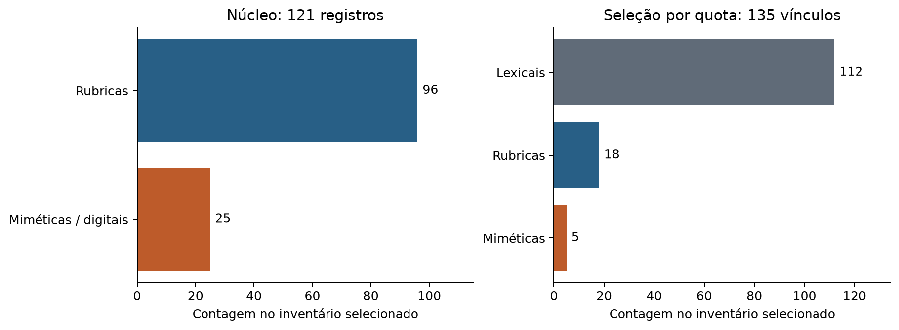
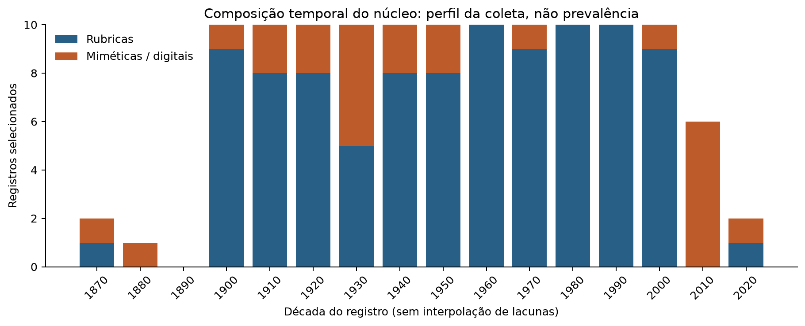
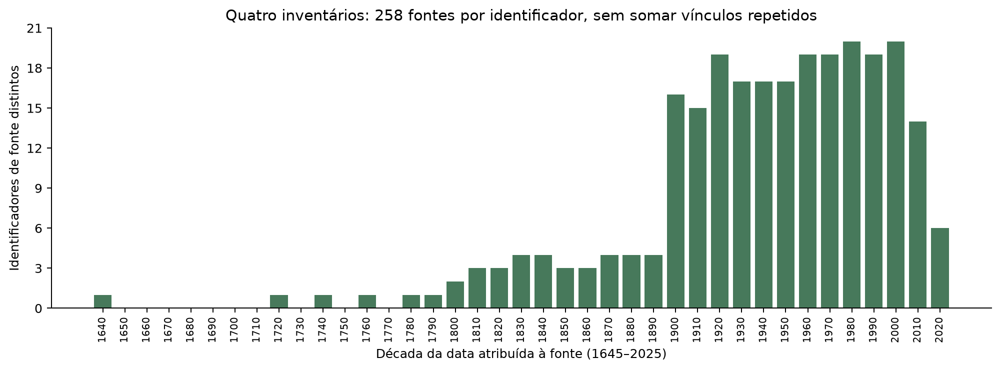
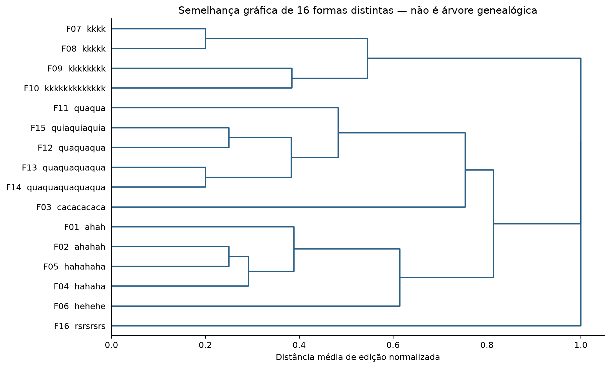
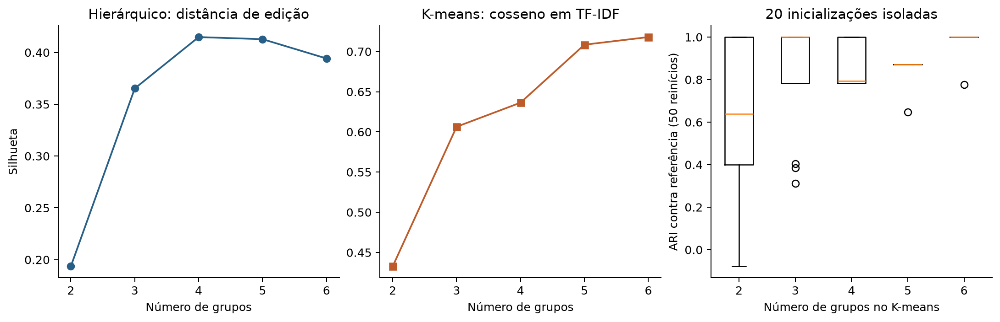
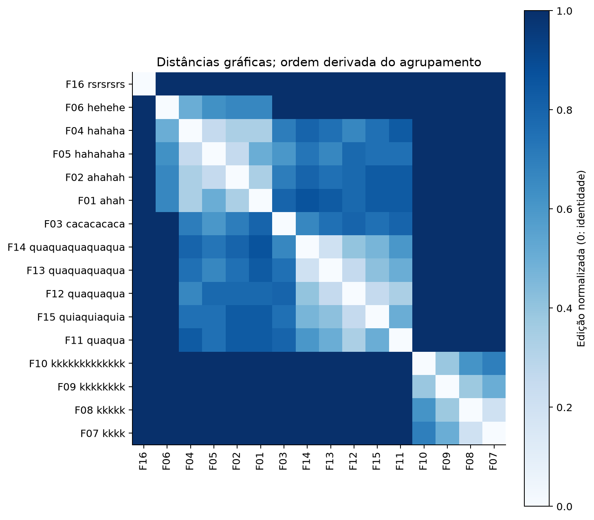

# Análise descritiva e agrupamento gráfico exploratório

Autor único: Murillo Edson de Carvalho Souza.

## Pergunta e escopo executado

A análise pergunta quais sequências selecionadas apresentam semelhança gráfica sob duas representações explícitas. Não testa descendência, origem absoluta, equivalência acústica ou prevalência nacional. Não foi treinado classificador supervisionado. A etapa usa os dados já auditados; não acrescenta novas atestações históricas nem transforma os cálculos prospectivos de amostragem em procedimentos executados.

A descrição utiliza os 121 registros do núcleo e os 135 vínculos de quota em painéis separados. O gráfico temporal do núcleo conserva 96 rubricas e 25 registros miméticos/digitais. Outro gráfico considera os 258 identificadores de fonte dos quatro inventários, de 1645 a 2025. Cada fonte aparece uma vez nesse último gráfico; a consistência do ano entre seus vínculos foi verificada. Esses gráficos descrevem a seleção; zeros não significam ausência histórica e diferenças entre décadas não estimam intensidade de uso.

## Unidade e pré-processamento

O agrupamento inclui somente os 25 registros classificados como miméticos ou digitais no núcleo. O campo `form` é um excerto codificado, não a extração exaustiva de todas as formas de cada fonte. Em A114, a barra separa duas variantes: `kkkkkkkk` e `rsrsrsrs`. Sua separação produz 26 vínculos em 25 registros documentais.

Aplica-se `casefold`, decomposição Unicode NFKD e retenção de letras. Acentos, espaços e pontuação são removidos para o cálculo, mantendo os originais no arquivo de vínculos. Não se faz conversão fonética ou substituição de `quiá`, `quá`, `cá` e `k` por uma categoria supostamente equivalente. Mantêm-se comprimentos e repetições. As 26 variantes resultam em 16 sequências normalizadas distintas, usadas com peso igual. Isso evita que sete referências à mesma sequência determinem artificialmente os grupos. A perda de informação por normalização limita a interpretação.

Ano, país, suporte, acervo, evidência e categoria não são variáveis dos modelos. A categoria documental participa apenas da seleção prévia do subconjunto. As datas da tabela são extremos dos registros selecionados, não primeira ocorrência absoluta nem duração de uso.

## Métodos e parâmetros

- Hierárquico: distância de Levenshtein dividida pelo maior comprimento do par; matriz simétrica; ligação média (`average`), com ordenação ótima das folhas. Ligação completa (`complete`) como sensibilidade. A silhueta é calculada na matriz de edição normalizada.
- K-means: TF-IDF de n-gramas de caracteres 1–3, normalização L2, `use_idf=True`, `smooth_idf=True`, `sublinear_tf=False`; semente 0, `n_init=50`, `init="k-means++"`, `algorithm="lloyd"`, `max_iter=300`, `tol=1e-4`. O objetivo é euclidiano quadrático; a silhueta usa cosseno em TF-IDF.
- Grade explorada: 2, 3, 4, 5 e 6 grupos. Escolha pelo maior valor de silhueta dentro de cada representação; empate exato favorece o menor k. Essa seleção interna não foi validada em conjunto externo.
- Sensibilidade do K-means: 20 sementes, 0–19, com uma inicialização por execução, comparadas à referência com 50 inicializações pelo ARI. Também se troca a faixa de n-gramas para 1–2 no mesmo k.
- Sensibilidade hierárquica: ARI entre ligação média e completa no mesmo corte.
- Comparação de métodos: ARI das partições selecionadas. Os números de grupo são arbitrários; o ARI não depende de sua numeração.

As silhuetas têm representações e distâncias diferentes e não são usadas para declarar um algoritmo superior. Sensibilidade a sementes não é intervalo de confiança, bootstrap populacional ou validação da inferência histórica. Usou-se uma thread para reduzir variações de execução. Os resultados numéricos dependem dos dados, da normalização e dos parâmetros.

Referências de implementação: [agrupamento no scikit-learn](https://scikit-learn.org/stable/modules/clustering.html), [ligação hierárquica no SciPy](https://docs.scipy.org/doc/scipy/reference/generated/scipy.cluster.hierarchy.linkage.html) e [ARI](https://scikit-learn.org/stable/modules/generated/sklearn.metrics.adjusted_rand_score.html).

## Resultados obtidos e limites

O hierárquico selecionou quatro grupos (silhueta 0,414812), mas cinco grupos tiveram 0,412783: a diferença de aproximadamente 0,002 não sustenta uma taxonomia definitiva. O K-means selecionou seis grupos (silhueta em cosseno 0,717997), no limite superior da grade, sem demonstrar ótimo global. O ARI entre as soluções selecionadas foi 0,783827.

No hierárquico, os conjuntos são: variantes ah/ha/he; sequências cá/quá/quiá; cadeias de k; e rs isolado. O K-means separa cá e hehehe, produzindo seis grupos. Há grupos unitários, compatíveis com o tamanho reduzido da coleção de formas. As cadeias de k e quiá/quá ficaram separadas nesses cortes, mas isso não comprova independência histórica. Uma eventual proximidade também não comprovaria transmissão.

No K-means com seis grupos, as inicializações isoladas tiveram ARI mediano 1,000 e mínimo 0,777365 contra a referência. A troca de n-gramas preservou a partição nesse corte (ARI 1,000). A troca de ligação média por completa preservou o corte hierárquico de quatro grupos (ARI 1,000). Esses resultados se restringem às perturbações testadas. Não foram avaliadas todas as escolhas de normalização, novos acervos ou grafias ausentes.

## Gráficos













## Reprodução e arquivos

Na raiz de uma cópia da versão escolhida:

```sh
python -m pip install -r requirements-analysis.txt
python scripts/build_appendices.py
python scripts/analyze_forms.py
python scripts/validate_analysis.py
tectonic -X compile artigo/main.tex --keep-logs --keep-intermediates
python scripts/validate.py
python scripts/package_release.py
```

`build_appendices.py` reconstitui os inventários documentais; `analyze_forms.py` calcula os resultados e redesenha os gráficos. Os geradores regravam arquivos derivados: use uma cópia de trabalho. O artigo pode ser compilado com as figuras e tabelas versionadas, sem executar novamente o agrupamento.

Os dados ficam em [data/analysis/](../data/analysis/):

- `summary.json`: parâmetros, versões e hash SHA-256 do CSV de entrada.
- `form_variants.csv`: 26 vínculos com os 25 registros, originais e sequências normalizadas.
- `form_units.csv`: 16 unidades, vínculo documental, datas selecionadas e grupos dos dois métodos.
- `normalized_edit_distances.csv`: matriz de distâncias.
- `tfidf_features.csv`: matriz de variáveis, sem datas ou categorias.
- `cluster_diagnostics.csv`: resultados para toda a grade, sem publicar apenas o melhor resultado.
- `initialization_sensitivity.csv`: ARI de cada uma das 100 execuções isoladas (cinco valores de k × 20 sementes).
- `partition_grid.csv`: partições por forma para os cinco cortes explorados, em ambos os métodos.
- `core_by_decade.csv` e `selected_sources_by_decade.csv`: bases dos gráficos temporais.

As figuras estão em PDF vetorial e PNG. Os PDFs vetoriais integram o pacote Overleaf. A reconstrução dos números não exige downloads dos originais, mas depende das decisões documentais previamente codificadas. O script contém verificações do retrato analisado (121 registros, 26 vínculos e 16 formas); uma expansão exige revisar essas verificações, os rótulos dos gráficos, executar novamente e revisar a interpretação. Não há avaliação preditiva supervisionada ou afirmação de que os grupos sejam categorias naturais da língua.
